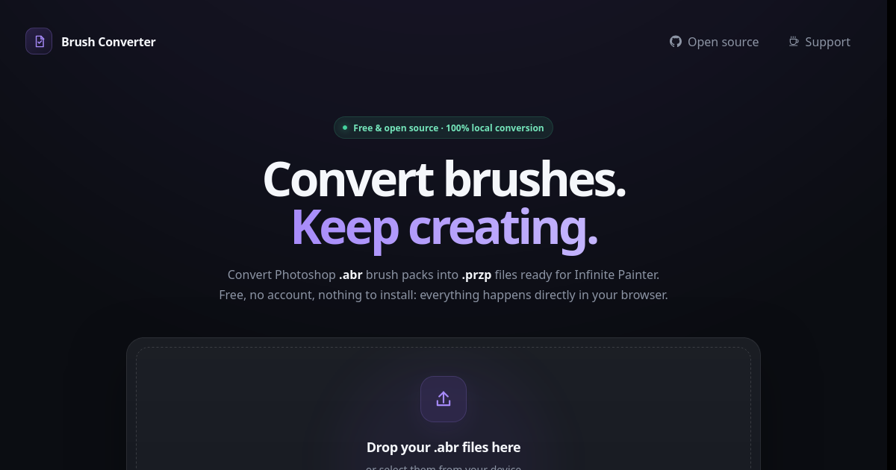

<div align="center">


# Brush Converter

**Convert Photoshop .abr brushes into Infinite Painter .przp packs — right in your browser.**

   

[](https://iurika-n-t-r.github.io/ABR-to-PRZP-Brush-converter/)
[](LICENSE)
[](https://github.com/Iurika-N-T-R/ABR-to-PRZP-Brush-converter/stargazers)

[**🌐 Open it**](#download) · [**📸 Screenshot**](#screenshots) · [**✨ Features**](#features) · [**🛠️ Build**](#build)

</div>

---

<a id="screenshots"></a>

## 📸 Screenshots

<div align="center">
<table>
  <tr>
    <td align="center"><br><sub><b>The web app</b></sub></td>
  </tr>
</table>
</div>

---

## 💡 What is Brush Converter?

Brush Converter helps **digital painters** bring their **Photoshop brushes into Infinite Painter**
without rebuilding them by hand. It converts the brush tip images and also the brush behaviour: spacing, jitter,
pressure and tilt dynamics, textures, stroke direction, color jitter and wet edges — calibrated against real
Infinite Painter packs. It is free, open source, and runs in your browser: **your brushes are never uploaded**.

On 156 test brushes: **154 complete, 2 partial, 0 failed**.

### 👥 Who is it for?

- 🎨 **Infinite Painter users** with a library of Photoshop brushes
- 📱 **Tablet & phone artists** — nothing to install, works in the mobile browser
- 🧑‍💻 **Tinkerers** who want a CLI (Linux, macOS, Windows, Termux) and a documented mapping

---

<a id="features"></a>

## ✨ Features

| | Feature | Description |
|:-:|---|---|
| 🌐 | **Runs in the browser** | Pick `.abr` files, download the `.przp` — no upload, no account |
| 🖌️ | **Tips & behaviour** | Spacing, jitter, pressure / tilt, textures, direction, color jitter, wet edges |
| 📦 | **Ready-to-import pack** | One `.przp` per file, plus `.prbr` per brush and full-res tips |
| 📊 | **Honest report** | Every Photoshop feature: exact, approximated, minor or lost |
| 💻 | **Command line** | Batch-convert folders, skips what's already converted |
| 🔒 | **Private by design** | Conversion is 100 % local |

<details>
<summary><b>📖 What gets converted (full mapping)</b></summary>

#### Output

```text
output/<name>/
├── <name>.przp      # pack to import into Infinite Painter
├── brushes/*.prbr   # one file per brush
├── tips/*.png       # full-resolution brush tips (8-bit grayscale)
└── report.json      # converted / partial / failed + unsupported features
output/<name>.log    # per-brush warnings
```

Every Photoshop feature is either converted exactly, **approximated** (the effect is carried by the closest Infinite Painter setting), **minor** (barely visible difference), or **lost**. A brush is **partial** only when something is lost; it still converts. **Failed** means nothing usable could be made from it. `report.json` lists the `unsupported` (lost), `approximated` and `minor` features; the `.log` marks losses as `"level":"warn"` and the rest as `"level":"info"`.

On 156 test brushes: 154 complete, 2 partial, 0 failed.

#### What gets converted

| Photoshop | Infinite Painter |
|---|---|
| Sampled tip (bitmap) | Custom head (capped at 2048 px), roundness and flip baked into the image |
| Computed round tip | Built-in round head, softness = 1 − hardness; elliptical ones become a custom head |
| Erodible / bristle tips | *Approximated* as a round head |
| Spacing | Spacing (× 0.5, range 0.5 %–200 %) |
| Tip angle | Head angle |
| Angle control "Direction" | Rotation: the head follows the stroke |
| Angle control "Rotation" / "Pen Tilt" / "Stylus Wheel" | Stylus rotation |
| Angle control "Initial Direction" | *Approximated* as Rotation |
| Size / angle / opacity jitter | Size / angle / flow jitter |
| Roundness by pressure / roundness jitter | *Approximated* as size by pressure / size jitter |
| Scatter, scatter by pressure | Scatter (× 0.1), pressure scatter dynamics |
| Scatter count | *Approximated* as a proportionally tighter spacing |
| Dual brush | *Approximated*: second tip used as the texture, or baked into the head when the brush already has a texture |
| Size, opacity, flow driven by pressure or tilt | Pressure / tilt dynamics, with curves built from the Photoshop minimum |
| Texture (pattern), scale, depth, invert | Custom stroke texture (depth mapped inverted, as the app expects) |
| Texture brightness / contrast | Baked into the texture image |
| Texture minimum depth | Start of the texture pressure/tilt curve |
| Color dynamics (hue, saturation, brightness) | Color jitter, per stroke or per stamp |
| Wet edges | Wet edges |

Each brush also gets a 512×128 stroke preview in Infinite Painter's own style.

**Lost** (makes a brush partial): "Fade" controls, foreground/background color dynamics, mixer and smudge tools.  
**Minor** (logged only): random flip per stamp, scatter count jitter, noise, color purity, brush pose. Texture blend modes are approximated by Infinite Painter's default texture style.

</details>

---

<a id="download"></a>

## 🌐 Use it

<div align="center">

<a href="https://iurika-n-t-r.github.io/ABR-to-PRZP-Brush-converter/">
  
</a>

</div>

### 🟢 In the browser (recommended)

1. Open **[https://iurika-n-t-r.github.io/ABR-to-PRZP-Brush-converter/](https://iurika-n-t-r.github.io/ABR-to-PRZP-Brush-converter/)** — on a computer, phone or tablet.
2. Pick your **`.abr`** files.
3. Download the **`.przp`** and import it into Infinite Painter. 🎉

### 🔵 Command line

Requires **Node.js 20.10 or newer**.

```bash
git clone https://github.com/Iurika-N-T-R/ABR-to-PRZP-Brush-converter.git
cd ABR-to-PRZP-Brush-converter
bash convert.sh my-brushes.abr
```

Then import `output/my-brushes/my-brushes.przp` into Infinite Painter.

```bash
bash convert.sh a.abr b.abr                # several files
bash convert.sh ~/Downloads/brushes/       # every .abr in a folder (recursive)
bash convert.sh my-brushes.abr -o ~/out    # custom output folder (default: ./output)
bash convert.sh --force ~/Downloads/brushes/   # reconvert everything
```

Files already converted are skipped: an `.abr` is converted again only if it changed, or if the converter itself was updated.
`convert.sh` checks Node, installs dependencies only when needed, rebuilds only when the source changed, then converts.

<details>
<summary><b>📱 Android (Termux)</b></summary>

```bash
pkg install nodejs git
git clone https://github.com/Iurika-N-T-R/ABR-to-PRZP-Brush-converter.git
cd ABR-to-PRZP-Brush-converter
bash convert.sh my-brushes.abr
termux-setup-storage                           # once, lets Termux write to shared storage
cp output/*/*.przp ~/storage/downloads/        # Infinite Painter can import from Downloads
```

Use `bash convert.sh`, not `./convert.sh`: Android often drops the execute permission on copied files.
</details>

> **Reads:** Photoshop 7 and newer (ABR v6–v10). Very old ABR files (v1–v2) and 16-bit RLE tips are not supported by the underlying parser.

---

<a id="build"></a>

## 🛠️ Build from source

<details>
<summary><b>For developers — click to expand</b></summary>

#### Stack

| Layer | Choice |
|---|---|
| Language | TypeScript (strict), ES modules |
| Runtime | Node.js ≥ 20.10 |
| ABR parsing | [ag-psd](https://github.com/Agamnentzar/ag-psd), plus two bug fixes applied on install (`scripts/patch-ag-psd.mjs`) |
| Zip writing (`.prbr`, `.przp`) | [JSZip](https://stuk.github.io/jszip/) |
| PNG encoding | [pngjs](https://github.com/pngjs/pngjs) |
| Hashing | `node:crypto` (BLAKE2b-512, used by Infinite Painter to reference heads and textures) |
| CLI | `node:util` `parseArgs` |
| Tests | `node:test` run through [tsx](https://github.com/privatenumber/tsx) |
| Launcher | Bash (`convert.sh`) |
| Web page | The same converter bundled with [esbuild](https://esbuild.github.io/), served by GitHub Pages from `docs/` |

#### How it works

```text
.abr ──ag-psd──▶ Photoshop brush ──photoshop.ts──▶ universal brush ──infinite-painter.ts──▶ .prbr / .przp
                   (abr-reader.ts)                   (universal.ts)
```

| File | Role |
|---|---|
| `src/abr-reader.ts` | Reads the ABR; renders tips, textures and previews to PNG |
| `src/universal.ts` | Format-independent brush model |
| `src/photoshop.ts` | Photoshop → universal mapping, with a warning for each unsupported feature |
| `src/infinite-painter.ts` | Universal → Infinite Painter `properties.json`, `.prbr` and `.przp` |
| `src/template-properties.json` | A real Infinite Painter brush used as the base; only mapped fields are changed |
| `src/convert.ts` | Converts a whole ABR and builds the report |
| `src/cli.ts` | Command-line entry point |
| `docs/index.html` | Web page; `docs/app.js` is `src/convert.ts` bundled for the browser |
| `scripts/web-shims.js` | Browser replacements for `Buffer` and `node:crypto`, used only by the web bundle |

#### Development

```bash
npm install
npm run build                          # compile src/ to dist/
npm test                               # unit + end-to-end tests
npm run build:web                      # rebuild docs/app.js (the web page) after changing src/
node dist/cli.js file.abr -o out --json   # also writes abr.json (dump of the ABR, without pixels)
```

The end-to-end test needs `Samples/Photoshop/Size Flow Gang.abr` locally; it is skipped otherwise. Sample brushes are not included in this repository because their licenses forbid redistribution.

Format notes, calibration results and the full mapping between the app's settings and `properties.json` fields are in `Projet Convertisseur ABR.md` (French).

</details>

---

## 🤝 Contributing

Ideas, bugs, translations — all contributions are welcome!

- 🐛 **Found a bug?** → [Open an issue](https://github.com/Iurika-N-T-R/ABR-to-PRZP-Brush-converter/issues/new)
- 💡 **Have an idea?** → [Open an issue](https://github.com/Iurika-N-T-R/ABR-to-PRZP-Brush-converter/issues) and describe it
- ⭐ **Like it?** → A star on this repo helps other people find it!
- ☕ **Want to support the work?** → [Buy me a coffee](https://buymeacoffee.com/iurika)

---

## 🧩 More apps by Iurika-N-T-R

<!-- Same block in EVERY repo: cross-linking boosts visibility of all the projects -->
| App | Description |
|---|---|
| [**iurikaFlows**](https://github.com/Iurika-N-T-R/iurikaFlows) | My open-source app store — installs and updates all my apps |
| [**DroRef**](https://github.com/Iurika-N-T-R/DroRef) | Reference board for artists, opens and saves PureRef `.pur` files |
| [**OnlyFlows**](https://github.com/Iurika-N-T-R/OnlyFlows) | Offline-first task & project manager with LAN sync |
| [**ColorFlows**](https://github.com/Iurika-N-T-R/ColorFlows) | Color harmonies, palettes from pictures, painter's shading sphere |
| [**galleryFlows**](https://github.com/Iurika-N-T-R/galleryFlows) | Gallery that browses your real folder tree |
| [**vidéoFlows**](https://github.com/Iurika-N-T-R/videoFlows) | Your own videos in a vertical swipe feed |
| [**RandomFlows**](https://github.com/Iurika-N-T-R/RandomFlows) | Randomizer & decision maker on your own lists |

---

<div align="center">

📄 Released under **[CC0 1.0](LICENSE)** — public domain

Made with ❤️ by [**Iurika-N-T-R**](https://github.com/Iurika-N-T-R)

<sub>If Brush Converter is useful to you, consider giving it a ⭐ — it really helps!</sub>

</div>
